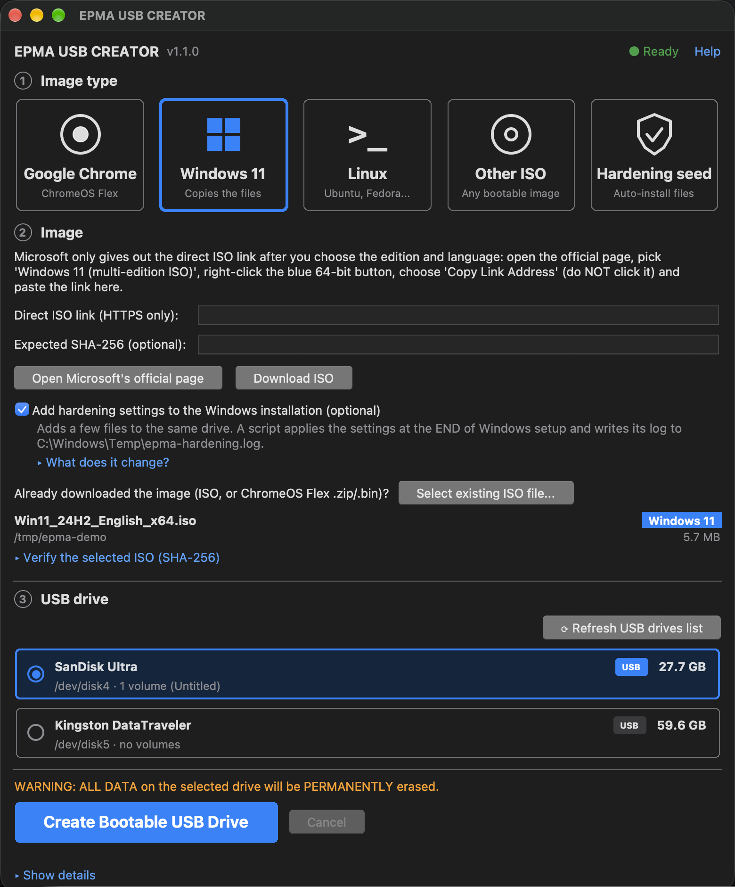
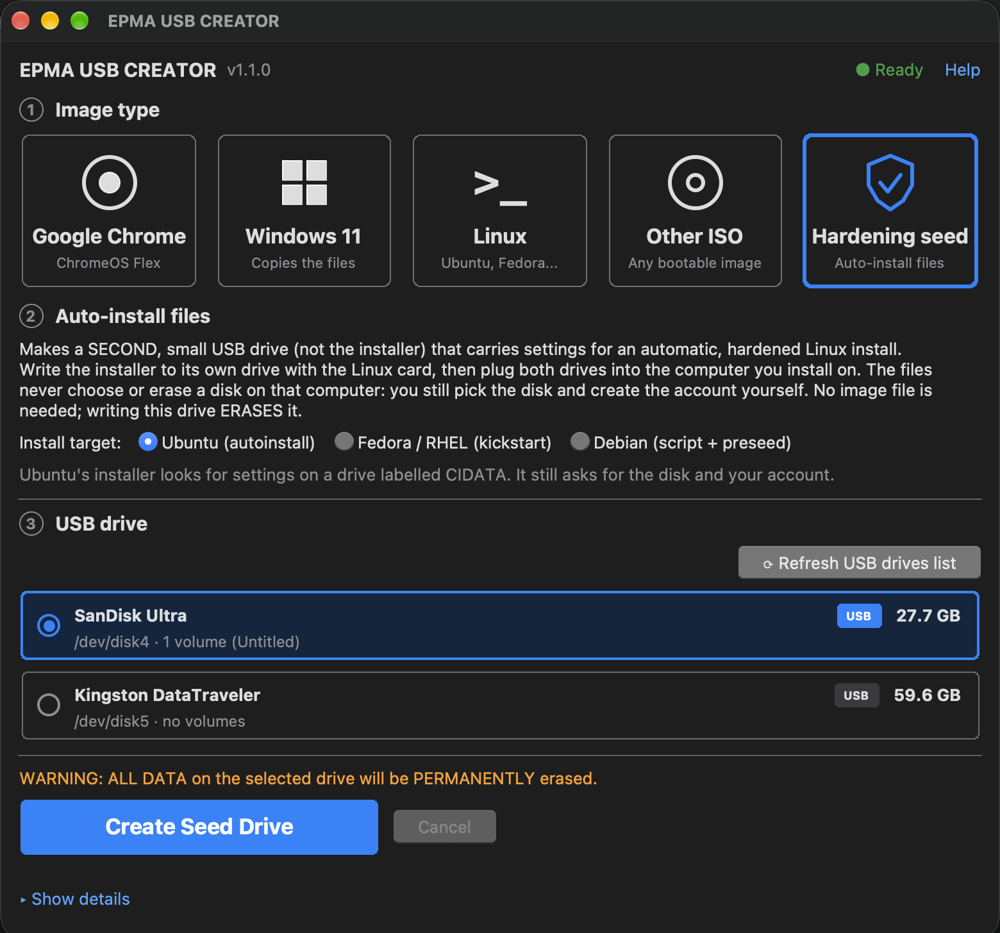

# EPMA USB CREATOR

**English** · [Português](README.pt-BR.md)

Cross-platform application (**macOS** and **any Linux distribution**) that downloads the official Windows 11 ISO and writes a bootable USB drive in **UEFI (GPT + FAT32)** format. It can also write **any hybrid ISO** (Ubuntu, Debian, Fedora, Mint, Arch…) and **Google's ChromeOS Flex** directly to a USB drive, and every write is **read back and verified** before the drive is ejected.

It has a graphical interface (US English) and a [command line mode](#command-line).

Written in pure Python with Tkinter — **zero third-party Python dependencies**.


[](https://github.com/1985epma/epma-windows-usb-creator/releases/latest)
[](https://github.com/1985epma/epma-windows-usb-creator/actions/workflows/ci.yml)

<p align="center">
  
  <br><em>The whole program in one window: choose the image type, the drive and the file, then create it.</em>
</p>

---

## Table of contents

- [Features](#features)
- [New in 1.1.0](#new-in-110)
- [How it works](#how-it-works)
- [Requirements](#requirements)
- [Installation](#installation)
- [Usage](#usage)
- [Security](#security)
- [Development](#development)
- [Troubleshooting](#troubleshooting)
- [Limitations](#limitations)
- [License](#license)

---

## Features

- **Download the ISO** from within the application, with a progress bar, transfer speed, time remaining and a cancel button.
- **Use an existing ISO** if you already downloaded the file in your browser.
- **Automatic formatting** of the USB drive as GPT + FAT32 with the label `WIN11USB` (UEFI-bootable, no need to disable Secure Boot).
- **Automatic splitting of `install.wim` / `install.esd`**: these files usually exceed 4 GB, the FAT32 size limit. The application detects this and splits the file into `.swm` parts using `wimlib-imagex`.
- **Automatic dependency installation**: detects your package manager (`apt-get`, `dnf`, `yum`, `pacman`, `zypper`, `apk`) or Homebrew on macOS and installs whatever is missing. Missing tools are detected **before** anything is erased: the Create button stays disabled, with a hint saying what to install.
- **Four image cards**: *Google Chrome* (ChromeOS Flex), *Windows 11*, *Linux* and *Other ISO*. *Windows 11* is formatted as GPT + FAT32 and its files are copied; the other three are written byte-for-byte, like `dd` (*Linux* and *Other ISO* write the same way). The card is picked from the image's **contents**, not its file name, and you can always change it.
- **ChromeOS Flex**: the *Google Chrome* card downloads Google's official image (`dl.google.com`, HTTPS, resumable), extracts it safely from the ZIP and prepares it for the USB drive. Regular ChromeOS is not distributed for ordinary PCs, so Flex — Google's free ChromeOS for PCs and Macs — is the official option.
- **Verified writes**: after writing, the drive is read back and compared with the ISO (byte for byte for Linux images; checksum comparison and `wimlib-imagex verify` for Windows). If anything differs the drive is **not** ejected and you are told not to use it.
- **Reliable eject** once the drive has been verified, with a clear message if the operating system refuses.
- **Progress bar** with percentage, speed and time remaining for writing and verifying; a **Cancel** button for the whole operation.
- **USB drives are found automatically** when the program starts and whenever you come back to its window, and a hint under the **Create** button says what is still missing (image file or drive) while it is disabled.
- **Protection against erasing the wrong disk**: only USB drives are listed with their model and volumes, the system disk is never shown, risky drives (large, holding data, looking like a backup disk) require you to **type the disk identifier**, and a final confirmation is always required. Closing the window while a drive is being written asks first, and a Windows ISO larger than the drive is refused up front.
- **SHA-256 check for an ISO you already have** (paste the expected value or a `SHA256SUMS` line).
- **Resumable downloads** with automatic retries.
- **Command line mode** (`list`, `write`, `detect`, `sha256`, `--dry-run`, JSON output, exit codes) for scripts.
- **Built-in documentation**: open **Help → EPMA USB CREATOR Help** (or press **F1**) for quick starts, a reference for the window and its five cards, safety, verification and eject, the command line, troubleshooting and the files/settings the program uses.
- **Integrity verification**: HTTPS-only downloads, warnings for unrecognised servers, and a SHA-256 checksum of the downloaded image.
- **Hardened setup (optional, experimental):** a Windows option and a *Hardening seed* drive for Ubuntu, Fedora/RHEL and Debian that start a fresh install from safer settings; see [Hardened setup](#hardened-setup-optional).
- **Real-time log** of every command executed, inside the application window: open **Show details** to read it (it opens by itself when a write fails).

## New in 1.1.0

- **One window, four cards** (Google Chrome, Windows 11, Linux, Other ISO), instead of separate screens.
- **ChromeOS Flex**: downloaded from Google, extracted safely and written to the drive.
- **Verified writes**: the drive is read back and compared before it is ejected, and the eject is reliable.
- **Command line mode** with `--dry-run`, JSON output and documented exit codes.
- **More protection against erasing the wrong disk**: model and volumes shown, typed confirmation for risky drives, serial-number re-check, dependencies checked before anything is erased.
- **Built-in help** (**F1**) and a **Cancel** button for the whole operation.
- Runs on Python up to **3.15**.

Every change is listed in the [CHANGELOG](CHANGELOG.md); downloads are on the [Releases](https://github.com/1985epma/epma-windows-usb-creator/releases) page.

## How it works

1. The ISO is mounted read-only (`hdiutil` on macOS, `mount -o loop,ro` on Linux).
2. The USB drive is wiped and repartitioned as GPT with a single FAT32 partition flagged as ESP.
3. All files from the ISO are copied with `rsync`, **except** `install.wim`/`install.esd`.
4. That large file is handled separately: if it fits within the FAT32 limit it is copied directly; if it exceeds 4 GB it is split into ~3.8 GB parts with `wimlib-imagex split`.
5. Writes are flushed to disk, the drive is remounted and **read back to verify** that every file matches the ISO (in Linux mode the ISO is written directly and the whole drive content is compared with it).
6. Only then is the USB drive safely unmounted and ejected.

## Requirements

### macOS

```bash
brew install python-tk@3.15 wimlib
```

> Python **3.10 or newer** is required. Use the `python-tk` formula that matches your Python version (for example `python-tk@3.15` for Python 3.15). In Windows mode macOS needs no `sudo` (disk operations go through `diskutil` and `hdiutil`); Linux mode, which writes the raw device, asks for your administrator password.

### Linux

Package names vary by distribution. Required tools:

| Tool | Debian/Ubuntu | Fedora/RHEL | Arch | openSUSE |
|---|---|---|---|---|
| `parted`, `partprobe` | `parted` | `parted` | `parted` | `parted` |
| `mkfs.vfat` | `dosfstools` | `dosfstools` | `dosfstools` | `dosfstools` |
| `wipefs` | `util-linux` | `util-linux` | `util-linux` | `util-linux` |
| `rsync` | `rsync` | `rsync` | `rsync` | `rsync` |
| `wimlib-imagex` | `wimtools` | `wimlib-utils` | `wimlib` | `wimlib` |
| GUI (Tkinter) | `python3-tk` | `python3-tkinter` | `tk` | `python3-tk` |

Example on Debian/Ubuntu:

```bash
sudo apt install python3-tk parted dosfstools util-linux rsync wimtools
```

Alternatively, just launch the application and use the **"Install missing dependencies"** button above the Create button — it builds and runs the correct command for your package manager.

On Linux, partitioning/formatting/mounting a raw block device requires root, so the application will ask for your administrator password (via `sudo`, or `pkexec` if `sudo` is unavailable).

## Installation

### Homebrew (macOS — recommended)

```bash
brew tap 1985epma/tap
brew trust 1985epma/tap
brew install epma-windows-usb-creator
```

Then run it with `epma-windows-usb-creator`.

Homebrew pulls in `wimlib` and a Python build with Tkinter automatically, so
there is nothing else to install. `brew trust` is required by Homebrew for any
third-party tap — it is a one-time confirmation that you accept code from this
tap.

### From a release

Each [release](https://github.com/1985epma/epma-windows-usb-creator/releases) has the program, its checksums and a software bill of materials. Download, check and run:

```bash
V=v1.1.0
curl -fsSLO https://github.com/1985epma/epma-windows-usb-creator/releases/download/$V/win11_usb_creator.py
curl -fsSLO https://github.com/1985epma/epma-windows-usb-creator/releases/download/$V/SHA256SUMS.txt
grep ' win11_usb_creator.py$' SHA256SUMS.txt | shasum -a 256 -c -          # must print: OK
gh attestation verify win11_usb_creator.py --repo 1985epma/epma-windows-usb-creator   # proves GitHub built it from this repository
python3 win11_usb_creator.py
```

### From source

```bash
git clone https://github.com/1985epma/epma-windows-usb-creator.git
cd epma-windows-usb-creator
chmod +x win11_usb_creator.py
```

**Verify the file before running it.** This application asks for your administrator password, which makes a tampered copy a worthwhile target for an attacker:

```bash
shasum -a 256 win11_usb_creator.py
```

For files downloaded from a [release](https://github.com/1985epma/epma-windows-usb-creator/releases), compare the result against the published `SHA256SUMS.txt`, or verify the build provenance attestation issued by GitHub:

```bash
gh attestation verify win11_usb_creator.py --repo 1985epma/epma-windows-usb-creator
```

## Usage

```bash
python3 win11_usb_creator.py
```

### The window

One window with three numbered steps — **1 Image type** (five cards: the four image types and the optional **Hardening seed**), **2 Image** (where to get it, and the file) and **3 USB drive** — and the **Create** button. A slim header shows the version, a **Ready** / **Missing tools** chip for the tools the program needs, and **Help**.

1. **Choose a card** — *Google Chrome* (ChromeOS Flex), *Windows 11*, *Linux* or *Other ISO*. The panel under the cards shows where to get that kind of image. Selecting an image file picks the right card for you, from the **contents** of the file.
2. **Get the image** (skip this if you already have it):
   - **Windows 11** — click **"Open Microsoft's official page"**, choose *Windows 11 (multi-edition ISO)* and your language, **right-click** the blue 64-bit button and choose **"Copy Link Address"** (do not click it). Paste the link, optionally paste Microsoft's SHA-256, and click **"Download ISO"**.
   - **Google Chrome (ChromeOS Flex)** — click **"Download ChromeOS Flex from Google"**; the ZIP is downloaded (resumable), extracted and selected for you. Details below.
   - **Linux / Other ISO** — download the ISO from your distribution's website.
3. **Select the file** with **"Select existing ISO file..."** (a ChromeOS Flex `.zip` is extracted for you). A **"Verify the selected ISO (SHA-256)"** link appears under the file name: click it, paste the published hash (or a `SHA256SUMS` line) and click **"Calculate SHA-256"**.
4. **Choose the drive** — plug in the USB drive (**8 GB minimum**; **16 GB or larger** for ChromeOS Flex) and select its row (model, size, volumes and a `USB` badge). The list is read when the program starts and whenever you return to its window; click **"Refresh USB drives list"** if the drive does not show up. While **Create** is disabled, a hint under it says why.
5. Click **"Create Bootable USB Drive"**. The final dialog shows the drive's model, size and volumes. For a **high-risk drive** (larger than 256 GB, with lots of data, or that looks like a backup/external disk) you must also type its identifier (for example `disk4`). Then the drive is erased and the image is written, verified and ejected. **Cancel** stops it; the drive is then left unusable until written again. Results appear under the button instead of in pop-up windows: a green box when the drive was verified and ejected (with **Make another**), a red box with **Try again** for a failed download.

What each card does:

- **Windows 11** — GPT + FAT32, the ISO files are copied (`install.wim` is split when over 4 GB).
- **Linux** and **Other ISO** — the image is written byte-for-byte to the drive (like `dd`). Use *Linux* for Ubuntu, Debian, Fedora, Mint, Arch… and *Other ISO* for any other bootable image. Images without a boot signature are refused before anything is erased.
- **Google Chrome (ChromeOS Flex)** — Google's disk image, also written byte-for-byte. The drive must be at least as large as the image (Google asks for 16 GB or larger).

If the file clearly does not match the card (for example a Linux ISO under *Windows 11*) the program asks before erasing anything, and a file that is not a ChromeOS Flex image under *Google Chrome* is refused.

> Administrator rights are needed on Linux, and on macOS for the direct-write cards (*Google Chrome*, *Linux*, *Other ISO*). The password is asked and verified right after you confirm, **before** the drive is touched (a wrong or canceled password changes nothing). A progress bar shows the percentage, speed and time remaining.
>
> **macOS and Linux/ChromeOS images:** macOS cannot read those images, so the finished drive will **not appear in Finder**, and macOS may say the disk is "not readable". Click **Ignore** — never *Initialize*. The content was already verified against the image.

The interface is always in US English. A Brazilian Portuguese translation exists and can be switched on explicitly with `EPMA_LANG=pt`; the system language is never used.

### ChromeOS Flex

[ChromeOS Flex](https://support.google.com/chromeosflex/answer/11541904) is Google's free version of ChromeOS for PCs and Macs. This program does not offer regular ChromeOS because Google does not publish it for ordinary computers.

1. Choose the **Google Chrome** card and click **"Download ChromeOS Flex from Google"**, then choose where to save the file. The ZIP is extracted automatically (and the ZIP the program downloaded is deleted). Already have `latest.bin.zip` or the `.bin` inside it? Use **"Select existing ISO file..."** — a ZIP is extracted for you.
2. Plug in a USB drive of **16 GB or larger** (Google's requirement), select it in the list (click **"Refresh USB drives list"** if it is not there) and click **"Create Bootable USB Drive"**.
3. Boot the target computer from the drive and follow [Google's guide](https://support.google.com/chromeosflex/answer/11541904).

Google lists these requirements for the computer: Intel or AMD 64-bit processor, 4 GB of RAM, 16 GB of internal storage and USB boot; it only guarantees certified models ([requirements](https://support.google.com/chromeosflex/answer/11552529)). Google also notes that some USB drives may not work as installers. ChromeOS Flex is provided by Google under Google's own terms.

### Hardened setup (optional)

Optional files that make a fresh install start from safer settings. They are **inspired by common security baselines**; the program does **not** claim that the result complies with, or is certified by, any standard. Nothing here chooses a disk, creates an account or sets a password or key: Windows Setup and the Linux installers stay interactive.

> **Experimental.** The scripts were checked with automated tests and simulated systems only (no real Windows, Debian, Ubuntu or Fedora install was run). Try them on a spare computer or a virtual machine first, and read the files before using them: `harden-files` writes them to a folder without touching any drive.

<p align="center">
  
</p>

- **Windows 11 (same USB drive):** tick **"Add hardening settings to the Windows installation (optional)"** on the Windows 11 card. A script runs at the **end** of Windows Setup (log: `C:\Windows\Temp\epma-hardening.log`) and turns off SMBv1 and LLMNR, AutoRun/AutoPlay, turns the firewall on, sets a few Microsoft Defender protections (one attack-surface rule in Block mode, four in Audit mode), disables the PowerShell 2.0 feature and WDigest credential caching, turns on script-block logging and an advanced audit policy (the Security log is raised to 128 MiB). **"What does it change?"** lists every setting with its risk. BitLocker, NTLM levels, accounts, disks, language and the product key are left alone. The files are checked byte for byte with the rest of the drive, and if the image already contains one of them the program stops **before** erasing anything.
- **Linux and others (a second USB drive):** raw-written ISOs cannot take extra files, so the **Hardening seed** card erases a **second, small** USB drive (GPT + FAT32) and writes the files on it. Keep your installer USB and plug the seed drive in next to it. **Ubuntu** (`autoinstall`, drive label `CIDATA`; add `autoinstall` to the boot line, every screen stays interactive), **Fedora / RHEL** (kickstart, label `OEMDRV`, found by the installer by itself) and **Debian** (the installer does **not** find the drive: mount it after installing and run `sudo bash harden-linux.sh`, or `su -` without sudo).
- **The Linux script** (`harden-linux.sh`) is plain text, supports `--dry-run`, `--yes`, `--undo` and `--help`, backs up every file it changes (`.epma-bak`), prints each change and logs to `/var/log/epma-hardening.log`. It is idempotent and tries not to lock you out: root or password login over SSH is only turned off when an administrator account with a key exists, and a firewall is not enabled on a computer that runs Docker, libvirt or LXD unless you pass `--yes`.

```bash
python3 win11_usb_creator.py harden-files --target ubuntu --out ./ubuntu-seed          # just the files, no drive
python3 win11_usb_creator.py harden-seed --target fedora --disk disk4 --dry-run        # plan for a seed drive
python3 win11_usb_creator.py write --iso Win11.iso --disk disk4 --hardened             # Windows + hardening files
```

### Command line

The same engine is available without the window (no Tkinter needed):

```bash
epma-usb-creator --help                 # Homebrew: epma-windows-usb-creator
python3 win11_usb_creator.py list                       # USB drives that can be used (--json available)
python3 win11_usb_creator.py detect ubuntu.iso          # windows | linux | chromeos | unknown
python3 win11_usb_creator.py sha256 ubuntu.iso --expected <hash>
python3 win11_usb_creator.py write --iso ubuntu.iso --disk disk4 --dry-run   # show the plan, change nothing
python3 win11_usb_creator.py write --iso ubuntu.iso --disk disk4             # asks you to type the disk id
python3 win11_usb_creator.py fetch-chromeos --dest ~/Downloads               # ChromeOS Flex: download + extract
python3 win11_usb_creator.py write --iso ~/Downloads/<image>.bin --disk disk4 --mode chromeos
```

The hardening commands (`harden-files`, `harden-seed`, `write --hardened`) are shown in [Hardened setup](#hardened-setup-optional).

`write` always verifies the drive and requires you to type the disk identifier (or pass `--yes` when there is no terminal). It never offers a way to skip verification. Run with no arguments to open the window.

| Exit code | Meaning |
|---|---|
| 0 | success |
| 1 | generic error |
| 2 | wrong usage or missing confirmation |
| 3 | verification failed / checksum mismatch |
| 4 | written and verified, but the drive could not be ejected |
| 130 | interrupted (Ctrl-C) |

Data goes to stdout; messages, progress and errors go to stderr. `NO_COLOR` is honored.

## Security

This application **completely erases** the selected disk and executes privileged commands. The implemented protections are:

### Preventing the wrong disk from being erased

- Only **USB** drives are listed. On macOS the internal disk is filtered twice (`diskutil list external physical` plus an explicit `Internal` flag check) and the bus protocol must be `USB`; on Linux the disk holding the root filesystem is excluded and only devices with USB transport are shown (SD cards and internal disks are not).
- **Fail closed:** if the application cannot *confirm* that a disk is external, it hides the disk instead of listing it. On Linux, disks holding `/`, `/boot` (or anything under it), `/boot/efi`, `/home`, `/usr`, `/var` or `/etc` are never listed, even when the system reports them as removable — this protects machines that boot from an SD card or USB stick, such as a Raspberry Pi.
- **You see what you are erasing:** the list and the final dialog show the model, size and volumes (with used space). Drives that are large, hold a lot of data or look like a backup disk require typing the disk identifier.
- **Re-verification before erasing:** immediately before writing, the application re-enumerates the disks and confirms the selected identifier still points to the same device with the same size **and the same serial/model**. Names such as `/dev/sdb` are recycled by the operating system — if a drive is swapped in between, the operation is aborted.
- A final confirmation dialog appears before any write occurs.
- **Checked before anything is erased:** missing tools are detected up front (Create stays disabled with a hint), a Windows ISO larger than the drive is refused, and closing the window during a write asks for confirmation first.
- **Nothing is retried blindly:** a privileged script that fails is never run a second time.
- **Verified before eject:** a mismatch aborts without ejecting and the drive is reported as unusable.
- **Hardening files are data, not decisions:** they never select or erase a disk, never create an account and never contain a password or key; a seed drive is erased like any other target and goes through the same checks, and an image that already ships the same files is refused before anything is erased.

> Even so: **double-check the selected disk before confirming.**

### Handling of the administrator password

The password is used solely to run local disk commands via `sudo`. It is checked once, over **`stdin` only** — never on the command line, where other users on the machine could see it with `ps` — and then normally dropped from memory: the operation continues on sudo's own credential timestamp, which is refreshed while it runs and invalidated (`sudo -k`) at the end. If this machine does not keep that timestamp, the password stays in memory **only until the operation ends** and is passed to `sudo` on `stdin` for each privileged command. It is **never logged, never written to disk and never transmitted anywhere**. Every run is recorded in an owner-only audit log, including the SHA-256 of the ISO that was written.

### Integrity of the downloaded image

The application accepts **HTTPS links only** and warns you if the server is not a recognised Microsoft download host; a redirect from a trusted host to an untrusted one is refused. After the download completes it displays the **SHA-256 checksum** of the file. If you supply an expected value, a mismatch causes the file to be discarded.

> **Always download from Microsoft's official website.** Never use a "faster mirror" link suggested in a forum or video — a tampered image would install a compromised Windows without you noticing.

### Security documentation

The threat model, implemented controls and optional environment variables are documented in [SECURITY.md](SECURITY.md).

Full audit reports (SCA, SAST, STRIDE, OWASP Top 10 and DAST) are in [output/](output/). Start with the [consolidated report](output/relatorio-consolidado-seguranca.md). *Note: the audit reports are written in Portuguese.*

## Development

### Running the checks locally

Before submitting a change, run the same checks the CI pipeline runs:

```bash
python3 verificar.py
```

This is safe: nothing touches a disk, formats anything, or requires administrator privileges. The unit tests run on their own with `python3 -m unittest discover -s tests -t .` (no Tkinter needed).

### Continuous integration

Every change is automatically checked by GitHub Actions (all actions are pinned by commit SHA):

| Workflow | Purpose |
|---|---|
| [`ci.yml`](.github/workflows/ci.yml) | Linting, unit tests (Python 3.10–3.15, Linux and macOS), ShellCheck of the embedded scripts, end-to-end tests on loop devices, Linux distribution probes |
| [`security.yml`](.github/workflows/security.yml) | Security regression guard, Bandit, Semgrep, CodeQL, secret scanning |
| [`release.yml`](.github/workflows/release.yml) | Publishes releases with SHA-256 checksums, build provenance and an SBOM; updates the Homebrew tap |
| [`scorecard.yml`](.github/workflows/scorecard.yml) | OpenSSF Scorecard supply-chain assessment |

The security pipeline is built in two layers: a dependency-free regression guard that verifies that every audit fix remains in place, plus external analysers as a second opinion. Each workflow file is extensively commented, explaining what every step does and why.

### Contributing

Third-party dependencies are deliberately avoided — this eliminates the most common supply-chain attack surface in modern software, and CI enforces it. If a dependency becomes genuinely necessary, the failing check explains the process to follow.

## Troubleshooting

**"Tkinter is not available for this Python installation"**
Install Tkinter for your Python version (see [Requirements](#requirements)).

**"wimlib-imagex not found"**
Install `wimlib` (macOS: `brew install wimlib`; Linux: see the table above) or use the dependency installation button.

**"Could not find sources/install.wim or sources/install.esd on the ISO"**
The selected image is not a Windows installation ISO. Download the official *multi-edition* ISO from Microsoft.

**"Only HTTPS links are accepted"**
The download link must start with `https://`. An unencrypted link can be modified in transit, which would let someone replace the Windows image with a tampered one.

**"Neither 'sudo' nor 'pkexec' was found"**
Install `sudo` or run the application as root.

**"Aborted for safety: /dev/sdX is no longer listed as an external drive"**
The device changed between selection and writing. Click *Refresh USB drives list* and select the drive again — this check exists precisely to prevent the wrong disk from being erased.

**No drives appear in the list**
Only drives attached over **USB** are listed (SD cards, internal disks and the system disk never are). Check that the drive is plugged in and click *Refresh USB drives list* (the list is also refreshed when you return to the window, but not while a write is running). The hint under the **Create** button says whether the list is empty or no drive is selected.

**The drive does not show up in Finder after a Linux ISO write (macOS)**
This is expected: macOS cannot read Linux images. If macOS says "the disk is not readable", click **Ignore**, never *Initialize*. The content was verified against the ISO before ejecting.

**"Verification FAILED"**
The data on the drive differs from the ISO. The drive was not ejected and must not be used. Write it again; if it keeps failing, try another USB port or drive.

**The USB drive does not appear in the boot menu**
Make sure the machine is in **UEFI** mode (not Legacy/CSM). The generated drive is UEFI + GPT and will not boot on legacy BIOS.

## Limitations

- Does not run on Windows (the script exits with an error on that platform).
- Produces **UEFI/GPT** media only — no legacy BIOS boot support.
- Does not bypass Windows 11 requirements (TPM 2.0 / Secure Boot).
- A cancelled or interrupted download keeps its partial file and resumes when the server supports it; a failed integrity check discards it.
- Formatting does not overwrite the previous contents of the USB drive. If it held sensitive data, wipe it first with `shred` (Linux) or "Erase securely" in Disk Utility (macOS).

## License

Copyright (C) 2026 EPMA

This program is free software: you can redistribute it and/or modify it under the terms of the **GNU General Public License, version 3**, as published by the Free Software Foundation, or (at your option) any later version.

This program is distributed in the hope that it will be useful, but **WITHOUT ANY WARRANTY**; without even the implied warranty of MERCHANTABILITY or FITNESS FOR A PARTICULAR PURPOSE. See the GNU General Public License for more details.

The full license text is in [LICENSE](LICENSE) and is also available at <https://www.gnu.org/licenses/gpl-3.0.html>.

---

> **Disclaimer:** Windows and Windows 11 are registered trademarks of Microsoft Corporation. Google, Chrome, ChromeOS and ChromeOS Flex are trademarks of Google LLC. This project is not affiliated with Microsoft or Google. The ISO is downloaded exclusively from Microsoft's official servers, and its use is subject to Microsoft's licensing terms.
